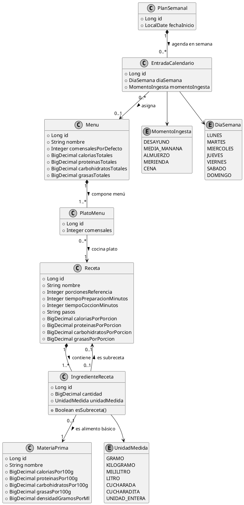

# ADR 001: Modelado de Persistencia para Ingredientes, Recetas Compuestas (Subrecetas), Menús y Planificación Temporal

- **Estado:** Aceptado
- **Fecha:** 2026-10-13
- **Autor:** Javier Liaño Rioz
- **Contexto del Proyecto:** P20 - Recipe and Meal Planning (Algebra Bernays University)

---

## 1. Contexto y Planteamiento del Problema

El sistema requiere gestionar recetas culinarias, materias primas de mercado, composición de menús multipase, planificación semanal de la alimentación y generación de listas de la compra agregadas.

A nivel de persistencia relacional con Spring Data JPA / Hibernate 7, surgen cuatro retos arquitectónicos clave:

1. **Atributos propios en la asociación Receta-Ingrediente:** Una receta no se limita a apuntar a un ingrediente; especifica una cantidad escalar precisa y una unidad dimensional fija.
2. **Composición recursiva (Subrecetas / Patrón Composite):** En gastronomía real, una receta compleja puede integrar insumos atómicos del mercado o elaboraciones intermedias (subrecetas) que son recetas completas con ingredientes propios.
3. **Desacoplamiento entre Menú y Calendario:** Un menú completo (primer plato, segundo, postre) debe ser una entidad autónoma y reutilizable en la biblioteca del usuario, independiente de si está agendado o no en una semana específica.
4. **Precomputación nutricional para lecturas $O(1)$:** El cálculo repetitivo de balances nutricionales recorriendo árboles de ingredientes en cada consulta degrada severamente el rendimiento de lecturas y filtrados masivos.

---

## 2. Alternativas Consideradas

### Opción A: Relación directa `@ManyToMany` simple sin entidades intermedias
- **Enfoque:** Relacionar directamente `Receta` con `MateriaPrima`, y `PlanSemanal` con `Receta`.
- **Descarte:** Inviable. Impide asociar atributos (`cantidad`, `unidadMedida`, `comensales` por plato) sin romper la normalización. Viola el requisito explícito de la asignatura (*"The hard part: Modelling the association entity with attributes properly instead of a bare many-to-many"*).

### Opción B: Fusión de Menú en el Calendario Semanal
- **Enfoque:** Asociar las recetas directamente a la ranura semanal (`EntradaCalendario` $\rightarrow$ `Receta`), sin la entidad `Menu`.
- **Descarte:** Impide modelar menús con varios platos simultáneos (ej. primero, segundo y postre), bloquea la asignación de comensales diferenciados por plato e imposibilita guardar menús reutilizables en una biblioteca personal.

### Opción C: Arquitectura Desacoplada con Entidades Intermedias y Precomputación (Elegida)
- **Enfoque:**
  - `IngredienteReceta` como entidad intermedia con atributos propios (`cantidad`, `unidadMedida`) y puntero excluyente hacia `MateriaPrima` o hacia `Receta` (subreceta).
  - `Menu` y `PlatoMenu` como agregado autónomo para componer propuestas gastronómicas con sus propios comensales.
  - `EntradaCalendario` como conector temporal entre `PlanSemanal` y `Menu`.
  - Columnas persistentes precomputadas en `Receta` y `Menu` para garantizar lecturas y filtros en tiempo constante ($O(1)$).

---

## 3. Decisión de Diseño Adoptada

1. **Entidad de Asociación con Atributos (`IngredienteReceta`):**
   - `Receta` mantiene `@OneToMany(mappedBy = "receta", cascade = CascadeType.ALL, orphanRemoval = true)` hacia `IngredienteReceta`.
   - `IngredienteReceta` almacena `cantidad` (`BigDecimal` de precisión fija) y `unidadMedida` (`UnidadMedida` enum).
   - `IngredienteReceta` implementa exclusión mutua: referencia a `MateriaPrima` (insumo atómico) o a `Receta` (subreceta).

2. **Garantía de Aciclicidad (Grafo Dirigido Acíclico - DAG):**
   - Una receta no puede contenerse a sí misma como subreceta de forma directa ni indirecta. El servicio de dominio ejecuta un algoritmo de detección de ciclos (DFS) previo a la persistencia.

3. **Desacoplamiento de Menús y Planificación Temporal:**
   - `Menu` agrupa uno o más `PlatoMenu` (cada uno con su receta y comensales específicos).
   - `PlanSemanal` tiene su ancla temporal limpia `fechaInicio` (`LocalDate`) y contiene `EntradasCalendario`.
   - `EntradaCalendario` vincula un `diaSemana` (`DiaSemana`) y un `momentoIngesta` (`MomentoIngesta`, incluyendo `MEDIA_MANANA`) con un `Menu` opcional.

4. **Estrategia de Precomputación Nutricional (RNF Rendimiento):**
   - Al persistir una `Receta`, se calculan y materializan en columnas dedicadas: `caloriasPorPorcion`, `proteinasPorPorcion`, `carbohidratosPorPorcion`, `grasasPorPorcion`.
   - Al persistir un `Menu`, se calculan y materializan: `caloriasTotales`, `proteinasTotales`, `carbohidratosTotales`, `grasasTotales`.
   - Dichas columnas disponen de índices B-Tree para habilitar búsquedas y ordenaciones inmediatas ($O(1)$).

---

## 4. Diagrama Estructural del Dominio de Persistencia

---

## 5. Consecuencias y Compensaciones (Trade-offs)

### Positivas
- **Fidelidad al mundo real:** Soporta menús multipase con raciones independientes por plato y recetas jerárquicas complejas.
- **Cumplimiento estricto de LO4:** Implementa rigurosamente entidades intermedias con atributos, evitando `@ManyToMany` planos.
- **Rendimiento de lectura $O(1)$:** Búsquedas, filtros nutricionales y listados operan a velocidad instantánea sobre índices B-Tree sin recalcular árboles en tiempo de petición.
- **Reutilización:** Los menús existen de forma autónoma y pueden asignarse a múltiples planes semanales o guardarse como plantillas.

### Negativas y Riesgos Gestionados
- **Coste de inserción:** Guardar una receta o menú requiere recorrer recursivamente el árbol para precomputar los totales. Aceptable dado que la tasa lectura/escritura es $> 100:1$.
- **Mantenimiento de consistencia:** Modificar una subreceta requiere invalidar y recalcular en cascada las recetas padre y menús dependientes.
- **Riesgo de consultas $N+1$ en JPA:** La carga de recetas con subrecetas y menús con múltiples platos exige el uso de *Entity Graphs* o *Fetch Joins*, aspecto clave para documentar y defender en el hito de optimización de LO4.
