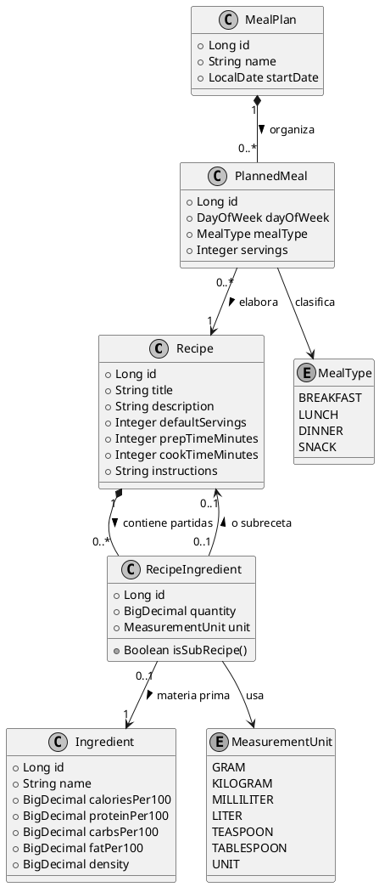

# ADR 001: Modelado de Persistencia para Ingredientes, Recetas Compuestas (Subrecetas) y Planificacion

- **Estado:** Aceptado
- **Fecha:** 2026-10-12
- **Autor:** Javier Liaño Rioz
- **Contexto del Proyecto:** P20 - Recipe and Meal Planning (Algebra Bernays University)

---

## 1. Contexto y Planteamiento del Problema

El sistema requiere gestionar recetas culinarias, ingredientes, planificación semanal de menús y generación de listas de la compra agregadas. 

A nivel de modelado de dominio y persistencia relacional con Spring Data JPA / Hibernate 7, surgen dos retos arquitectónicos centrales:

1. **Atributos en la asociación Receta-Ingrediente:** Una receta no solo referencia un ingrediente; especifica una cantidad y una unidad de medida precisas para dicha receta.
2. **Composición recursiva (Subrecetas):** En gastronomía real, una receta compleja puede componerse tanto de ingredientes básicos (ej. sal, harina) como de elaboraciones intermedias o subrecetas (ej. salsa bechamel, masa quebrada, caldo de verduras), que a su vez son recetas autónomas con sus propios ingredientes, tiempos e instrucciones.

---

## 2. Alternativas Consideradas

### Opción A: Relación directa `@ManyToMany` simple sin entidad intermedia
- **Enfoque:** Mapear `Recipe` con una colección `@ManyToMany Set<Ingredient>`.
- **Descarte:** Inviable. Impide asociar atributos propios (`quantity`, `unit`) a la relación sin desnormalizar o forzar estructuras externas frágiles. Viola explícitamente el requisito fundamental del proyecto P20 (*"The hard part: Modelling the association entity with attributes properly instead of a bare many-to-many"*).

### Opción B: Entidad de asociación fija separada para ingredientes y para subrecetas
- **Enfoque:** Crear dos tablas distintas: `RecipeIngredient` (apuntando a `Ingredient`) y `RecipeSubRecipe` (apuntando a `Recipe`).
- **Descarte:** Duplica lógica de escalado de raciones, cálculo de costes, interfaz gráfica y agregación de listas de compra. Trata de forma artificialmente distinta a dos componentes que conceptualmente desempeñan el mismo rol: ser una partida cuantitativa dentro de la receta.

### Opción C: Patrón Composite / Asociación Polimórfica o Dual en `RecipeItem` (Elegida)
- **Enfoque:** Modelar la entidad intermedia `RecipeIngredient` (o `RecipeItem`) vinculada al agregado `Recipe`, capaz de resolver tanto un ingrediente base (`Ingredient`) como una subreceta (`Recipe`), garantizando recursividad y cálculo acumulativo de nutrientes y listas de compra mediante resolución en árbol / grafo dirigido.

---

## 3. Decisión de Diseño Adoptada

Se adopta una **entidad de asociación explícita con atributos** (`RecipeIngredient` / `RecipeItem`) junto con el soporte recursivo para subrecetas:

1. **Entidad de Asociación con Atributos:**
   - `Recipe` posee una relación `@OneToMany(mappedBy = "recipe", cascade = CascadeType.ALL, orphanRemoval = true)` hacia `RecipeIngredient`.
   - `RecipeIngredient` almacena `quantity` (`BigDecimal` para precisión sin errores de redondeo de coma flotante) y `unit` (`MeasurementUnit` enum).
   - `RecipeIngredient` referencia a `Ingredient` (cuando es materia prima básica) o a otra `Recipe` como `subRecipe` (cuando es una elaboración intermedia).

2. **Detección de Ciclos (Recursión Segura):**
   - Una receta no puede contenerse a sí misma ni directa ni indirectamente (ej. $A \rightarrow B \rightarrow A$). El servicio de negocio valida la aciclicidad del grafo antes de persistir una subreceta.

3. **Planificación Semanal (`MealPlan` y `PlannedMeal`):**
   - `MealPlan` representa el agregado de la semana para un usuario.
   - `PlannedMeal` actúa como entidad intermedia con atributos contextuales: día de la semana (`DayOfWeek`), tipo de ingesta (`MealType`), número de comensales/raciones objetivo (`servings`) y la `Recipe` asignada.

---

## 4. Diagrama de Dominio (Entidad-Relación y Agregados)

---

## 5. Consecuencias

### Positivas
- **Fidelidad al mundo real:** Soporta recetas compuestas complejas (ej. lasaña = pasta + boloñesa + bechamel) con cálculo exacto de tiempos y materias primas.
- **Cumplimiento estricto de LO4:** Cumple la exigencia de entidad intermedia con atributos y relaciones `@OneToMany` / `@ManyToOne` explícitas.
- **Escalabilidad algorítmica:** El cálculo nutricional y la lista de la compra se reducen a un recorrido en profundidad (DFS) estándar sobre el árbol de la receta.

### Negativas / Riesgos Asumidos
- **Complejidad de validación:** Se debe impedir activamente que el usuario cree bucles infinitos (recursión circular) al asignar subrecetas.
- **Riesgo de consultas $N+1$:** Cargar recetas con múltiples niveles de subrecetas puede disparar consultas SQL si no se configuran *fetch joins* o *entity graphs* adecuados (requisito que se documentará y medirá para LO4).
